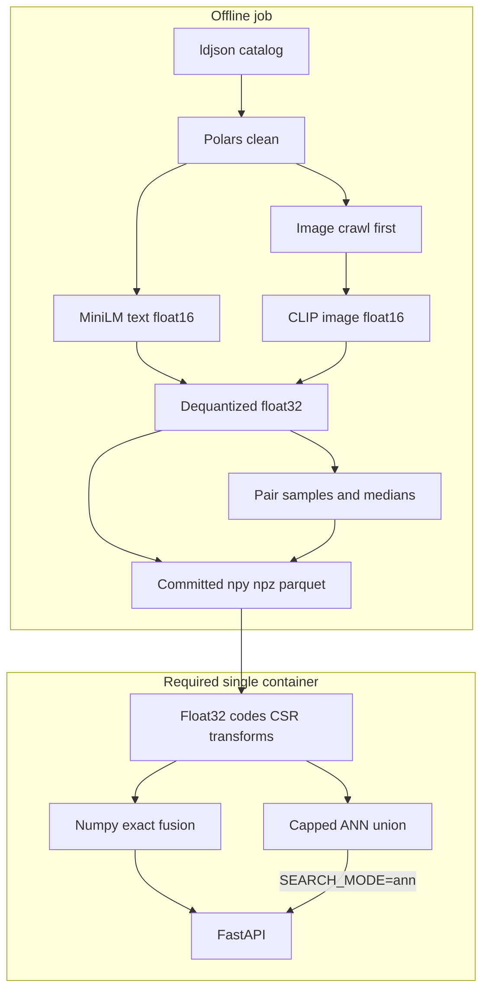

# Hybrid product similarity service

The README requires `find_similar_products`, `GET /find_similar_products`, a deployable Dockerfile, and **Kubernetes deployability**. Bonus is an ANN index you can defend with a paper. Image is a required Part 1 attribute.

**Required:** one container, vectorized late fusion, FastAPI, tests, a single [`k8s.yaml`](k8s.yaml) (Deployment, Service, probes, resources, non-root, **`imagePullPolicy: IfNotPresent`**), and [docs/DESIGN.md](docs/DESIGN.md) whose figures come from [`scripts/evaluate.py`](scripts/evaluate.py). **Stretch:** Qdrant/compose after the skeleton works.

**Single source of numbers.** `make eval` writes [`docs/eval.json`](docs/eval.json). DESIGN.md quotes that file.

Reviewer path: clone and `make run-local`. Float16 embeddings (~23MB + ~31MB) are **committed in git once**. No LFS (ZIP downloads would be pointer files; free LFS bandwidth is small). No `make fetch`. The **Dockerfile `COPY`s `artifacts/`**, so `docker run` and kind/minikube (`kind load` / `IfNotPresent`) need no extra download. Startup checks sha256 against the manifest.

## Architecture



- **Exact (default).** Full-catalog numpy/scipy. FAISS is not used.
- **ANN.** Capped union: HNSW 500 ∪ same-brand 500 ∪ same-child 500, then the same scorer. Brand/category is a posting list. The 1M bench is **pure HNSW**; union-at-1M is unmeasured.
- **k8s.yaml (required).** ~40 lines, `IfNotPresent`. README for kind: `kind load docker-image`.
- **Qdrant (stretch).** Named vectors, PVC.

## Scope cut

No Redis, no Qdrant-as-exact, no LFS, no cachetools (stdlib `functools.lru_cache`). Kubernetes is not cut.

## Strict coding standards

mypy `--strict` and ruff via `make lint`. Untyped FAISS isolated in [`service/index.py`](service/index.py).

## Rich API documentation

Pydantic `Field` with descriptions and examples. JSON array of strings; **may be shorter than `num_similar`**. `/explain`: calibrated `value`, raw `sim`, `imputed`, `transform`. Errors: `detail` + `code`.

## Directory structure (no extra dirs)

- [`app.py`](app.py), [`service/cleaning.py`](service/cleaning.py), [`service/scoring.py`](service/scoring.py), [`service/catalog.py`](service/catalog.py), [`service/index.py`](service/index.py), [`service/cache.py`](service/cache.py), [`service/api.py`](service/api.py), [`service/config.py`](service/config.py)
- [`scripts/build_index.py`](scripts/build_index.py), [`scripts/evaluate.py`](scripts/evaluate.py), [`scripts/bench_hnsw.py`](scripts/bench_hnsw.py)
- [`tests/`](tests/), [`docs/DESIGN.md`](docs/DESIGN.md), [`docs/eval.json`](docs/eval.json)
- [`k8s.yaml`](k8s.yaml), Makefile, requirements files, `pyproject.toml`, Dockerfile, `.dockerignore`, `.github/workflows/test.yml`

No `.gitattributes` LFS. Stretch later: `scripts/load_qdrant.py`, `docker-compose.yml`.

## Tooling

**requirements.txt:** `fastapi`, `uvicorn`, `polars`, `numpy`, `scipy`, `faiss-cpu`, `pydantic-settings`. No cachetools.

**requirements-dev.txt:** plus `ruff`, `mypy`, `pytest`, `httpx`, `scikit-learn`.

**requirements-index.txt:** plus `torch`, `transformers`, `sentence-transformers`, `pillow`.

Makefile: `lint`, `test`, `build`, `run-local`, `index`, `eval`, `bench`.

[`scripts/build_index.py`](scripts/build_index.py): Polars `read_ndjson(..., infer_schema_length=None)` or an explicit schema (this catalog has mixed-type fields). Crawl first. Write parquet, float16 npy, mask, `cdf.npz`. Pair samples **and per-transform medians** are computed after `float16 → float32`. Manifest: models, dims, row count, sha256, `image_coverage`, frequencies, `sum_p2`, **`mu` per block per transform**.

## Scoring

### Text/image transform experiment

Uniform percentile flattens influence in the head. Three maps, **each with its own tuned weights** (matvec search is cheap; shared weights would bias the table toward whichever transform was tuned first):

1. **raw** — L2 cosine.
2. **percentile** — mid-rank on a sorted ~200k pair sample from serving float32:
   ```
   x finite; NaNs masked before searchsorted
   left  = searchsorted(sample, x, side="left")
   right = searchsorted(sample, x, side="right")
   p     = (left + right) / (2 * n)
   ```
3. **tail-log** — spreads the head:
   ```
   eps = 1 / (2 * n)                         # n = 200_000 → 2.5e-6
   s   = -log10(clip(1 - p, eps, 1)) / -log10(eps)
   ```
   Ceiling is **`-log10(1/(2n))`**, not 12. The `1e-12` clip is meaningless at this n: the largest mid-rank p is `1 - 1/(2n)`, so `-log10(1-p)` maxes at ~5.6. Dividing by 12 put **all observed s in ~[0, 0.47]**.

Default before the table: **tail-log** for text and image. Color, price, rating, weight stay mid-rank percentile. DESIGN.md reports the winner.

Final fusion scores are **float64**. Tie-break: round to **1e-6** (float32 ulp at 1.0 is ~1e-7; `1e-9` is just equality), then `np.lexsort` on `(-score, -rating, price_with_missing_last, uniq_id)`.

### Missing = median of the *transformed* sample

Imputing 0.5 is correct **only** for mid-rank percentile. Under tail-log scaled by 12, median p=0.5 maps to ~0.025 and s_max≈0.47, so **missing 0.5 beats every observed pair**, including a near-identical image. Raw median cosine is ~0.1–0.3, so 0.5 also beats typical observed images.

**Per transform, per block:** `μ = median(transform(pair_sample))`, stored in the manifest.

- percentile → 0.5
- tail-log (correct ceiling) → `-log10(0.5) / -log10(1/(2n))` ≈ 0.05
- raw → median pair cosine (measured, not assumed)

A dead image URL therefore scores the **typical** pair, not above a near-duplicate.

**Required test:** under the shipped text/image transform, a candidate with a **missing image** scores **below** a candidate with an observed near-duplicate image (cosine ~0.95), all other blocks equal. That test would have caught the 0.5 bug.

Color mismatch (raw 0, large atom) still mid-rank ≈ p_atom/2 ≈ 0.45, which is **below** percentile-missing 0.5. Keep that test.

### Categorical missing cannot beat a match

`β ∈ (0, 1]`. `imputed = min(β * μ, 0.5)`. Audience μ is **E[table]** under the class distribution, not `p(exact)`. Both sex regexes → `unisex`.

### Nearly dead blocks

Color 6,029 / weight 6,254 / rating 3,452. Report pair-active rates. LOO CIs that contain 0 are inactive, not features.

### Starting weights and search

Start: text 0.30, image 0.15, category 0.15, audience 0.08, brand 0.10, color 0.08, price 0.08, rating 0.04, weight 0.02. **Repeat the search independently for raw, percentile, and tail-log.**

Search: 40 draws from **Dirichlet(c · w₀)** with **c = 30**, `β ∈ {0.5, 1.0}`, two coordinate-ascent passes. Freeze on tune NDCG@10, tie-break hit-rate@10.

**Memory.** `3000 × 30000 × 9 × 4 ≈ 3GB`, worse with per-β copies. Do **not** materialize full-catalog `S_i`. For each of 2–3k tune queries, keep only the **top 3,000 text-cosine candidates** (plus the query’s relevant title-groups if they fell outside, so NDCG is defined). Then `3000 × 3000 × 9 × 4 ≈ 320MB` (float32) or half in float16. Each weight vector is still a matvec on that pool.

### Vectorization at load

[`service/catalog.py`](service/catalog.py): float16 → float32 once; codes; frequencies; color CSR; NaN arrays; sorted samples; `mu[transform][block]`; `id_to_row`. Mask NaNs before `searchsorted`. No Python string loops over 30k.

### Blocks

- **Text.** MiniLM `all-MiniLM-L6-v2` on `product_name`. Transform = experiment winner. Missing → `μ[transform][text]` (text is always observed in this catalog).
- **Image.** CLIP on first `medium` URL. Same transform. Missing → `μ[transform][image]`.
- **Category.** Child key. Same child 1.0 else 0. Missing → `min(β p, 0.5)`. `browsenode` not in the score.
- **Audience.** `women|men|girls|boys|baby|kids|unisex|unknown`. Child-key prefix authoritative (`Kids` → `kids`). Title regex only if prefix absent: `\bwomen['’]?s?\b`, `\bmen['’]?s?\b`, etc. **Men and women both hit → unisex.** Table as before. Missing → capped E[table].
- **Brand.** Exact case-fold. Empty/`generic` missing. Else `min(β p, 0.5)`.
- **Color / price / rating / weight.** Raw sims, mid-rank percentile, missing → 0.5 (that transform’s median). n=0 rating missing. Weight sentinel missing.

### Variant dedup

Tokenize, drop possessives, drop size tokens as whole tokens, strip color words. Group key `(normalized_title, brand_code)`. Suppress the query group. At most one id per remaining group. **If groups < `num_similar`, return fewer.**

## ANN and the Part 3 claim

Paper: Malkov and Yashunin, arXiv:1603.09320 (2016), IEEE TPAMI **42(9):2487–2500, 2020**.

[`scripts/bench_hnsw.py`](scripts/bench_hnsw.py): 1M × 384 bootstrap from real MiniLM; **total noise norm ≈ 0.01**; queries are **held-out real vectors not in the index**; M=16, efConstruction=200, efSearch sweep; recall@10 vs Flat, p50/p95. **Pure HNSW.** Union-at-1M unmeasured. Brand/category = posting lists. Not in CI; 5k smoke only.

Real-catalog ANN: each source capped at 500.

## Online service

- `GET /find_similar_products` → JSON list, possibly short. 422 / 404 / 503.
- `GET /explain` → DESIGN.md worked example.
- Cache: `functools.lru_cache` **`maxsize=4096`**, key `(product_id, mode)`, store top-50, slice.
- Latency: exact path on 1,000 query ids; p50/p95 in `eval.json`. No Redis.

## Evaluation

`evaluate.py` → `docs/eval.json` only.

Split by **title_group**. Cluster bootstrap. Co-purchase title_group hit-rate, recall, NDCG@10.

Validity check + popularity baseline (same child, by reviews / sales rank).

Baselines: random; random same-child; popularity; TF-IDF; MiniLM-only **and** full fusion under each transform, **each fusion row using that transform’s own tuned weights**.

LOO of the shipped fusion. Pair-active rates. Group-size histogram.

Sanity-only: `tests/fixtures/labeled_pairs.json`.

## Tests (synthetic 20-row catalog)

- query id absent; list may be shorter than `num_similar`
- **missing image < observed near-duplicate** under shipped transform (all other blocks equal)
- brand/audience: match > capped imputed > mismatch at β=1, majority `p>0.5`
- audience missing uses E[table]
- “Men and Women” → unisex
- color raw-0 < percentile-missing 0.5
- tail-log scaled by `-log10(1/(2n))` reaches ~1.0 at the sample max; two head cosines keep a larger gap than percentile
- `Womens` / `Women's` → women; `female` ≠ male; `Kids` → kids
- tokenize-then-size-drop; brand in group key
- n=0 rating missing; OpenAPI Fields; 404/422
- no HNSW recall assertion on 20 rows

## DESIGN.md outline

1. Problem and data (`eval.json` / manifest).
2. Scoring: transform experiment **with per-transform weights and per-transform μ**; which one shipped; why 0.5 is not the missing value for tail-log/raw.
3. Worked example: one `uniq_id`, top 5 from `/explain`.
4. Evaluation: validity; baselines + popularity + three transforms with cluster-bootstrap CIs; LOO; pair-active rates.
5. ANN: capped union; pure-HNSW 1M bench; union-at-1M unmeasured.
6. Latency: exact p50/p95 over 1,000 queries.
7. Limitations: dead blocks, popularity skew, image coverage.
8. If time runs out: (1) cleaning + exact fusion + FastAPI + Dockerfile + tests + **k8s.yaml**, (2) evaluate.py + DESIGN.md 1–4 and 6, (3) committed artifacts, (4) ANN + 1M bench, (5) Qdrant.

## Stretch (after skeleton)

Qdrant named vectors, PVC, loader Job, optional compose. No Redis.

## What we still do not include

No Postgres/Mongo, Helm, Kafka, auth, tracing, PCA, t-SNE, Redis, LFS, encoding in the API process, or extra directories.
