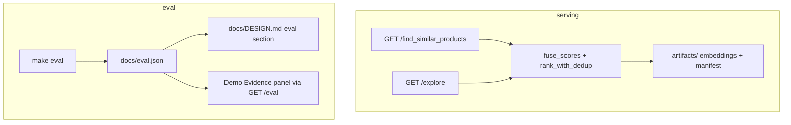

# Implementation summary: verifiable rankings demo

This document summarizes what was built for the **verifiable rankings demo** plan: a hybrid product-similarity service, an auditable explore UI, dedup fixes, and an expanded evaluation pipeline. **`GET /find_similar_products` is unchanged** (still returns a list of product IDs).

<!-- current_state:start -->
## Current state (from eval.json)

_Run `make eval` to populate this block from `docs/eval.json`._
<!-- current_state:end -->

---

## 1. Overall architecture

The system scores every catalog row against a query using **nine fusion blocks** (text, image, category, audience, brand, color, price, rating, weight), combines them with **normalized weights**, applies **title-group deduplication**, and returns ranked product IDs.

### Serving modes

- **Exact** (default): score full catalog; explore always uses this.
- **ANN** (`SEARCH_MODE=ann`): capped candidate union (HNSW + brand/category lists), then same fusion; production endpoint behavior unchanged.

---

## 2. Core scoring (existing + refactored)

### Nine-block late fusion

Each block produces a calibrated value in \([0, 1]\) (or imputed μ when data is missing). Fusion is a **weighted sum** after normalizing weights to sum to 1.

| Block | Typical signal |
|--------|----------------|
| **text** | MiniLM cosine → transform (shipped: **tail_log**) |
| **image** | CLIP cosine (inactive if no images indexed) |
| **category** | Binary same child category, or **affinity** variant (see below) |
| **audience** | Match or table-based expectation |
| **brand** | Match or frequency-based imputation |
| **color** | Sparse color vocabulary cosine |
| **price / rating / weight** | Similarity on numeric fields with pair-calibrated transforms |

**Transforms** for text/image continuous scores: `raw`, `percentile`, **`tail_log` (shipped)**. Missing text/image use transform-specific μ from pair samples (`eval.json` → `mu_transform`).

### Refactor: `block_details` / `block_batch`

Scoring was centralized so one path feeds explain, explore, and matrix APIs:

- **`service/block_batch.py`** — `compute_block_batch` returns calibrated **values**, **raw similarities**, **imputed** flags, and **reason** strings (`query … missing`, `candidate … missing`, etc.).
- **`service/catalog.py`** — `block_matrix` is a thin wrapper; `block_details` is the full structure; `scores_for_query` still fuses in one line.
- **`service/similarity.py`** — `explain_one` reads `block_details`; `find_similar_products` accepts optional `profile`.

Fusion math and `/explain` response shape for text raw + imputed booleans are preserved for backward compatibility.

### Pluggable scoring profiles (`service/scoring_profile.py`)

| Variant | Category block | Text embeddings |
|---------|----------------|-----------------|
| **binary** (default) | Same child category 0/1 | `text_embeddings.npy` |
| **A** | Centroid cosine affinity | default |
| **B** | binary | **brand-stripped** re-encode (`text_embeddings_nobrand.npy` if present) |
| **A+B** | affinity | nobrand |

`load_catalog` sets `active_profile` from manifest `selected_variant`; **`api.py` lifespan** also applies `selected_variant` from `artifacts/tuned_weights.json` when that file exists.

### Query masks (`service/query_overrides.py`)

For explore only: `mask=brand` / `mask=image` treat the query as missing brand or image for scoring branches **without** mutating stored `brand_code` or image mask in the catalog.

### Dedup (`service/scoring.py` + `service/cleaning.py`)

- **`rank_with_dedup_detailed`** — same ranking as before, plus `duplicates_collapsed` for meta.
- **Title-group fix** — if a normalized title has **exactly one** known `brand_code`, rows with `brand_code == -1` (missing brand) **join that group**. Colorway siblings with missing brand no longer appear as separate recommendations. Monte Carlo grey/black tracksuits (both `-1`) are unchanged. Ambiguous titles (two+ real brands) are not merged.

### Category helpers

- **`category_family_key`** — audience prefix stripped, first CamelCase token for eval “same family” metrics.
- **`strip_brand_from_title`** — for nobrand embedding build in index pipeline.

---

## 3. Explore API and demo backend

### `GET /explore` (`service/explore.py`, `service/ui_api.py`)

- Params: `product_id`, `n` (1–200), optional `mask=brand,image`.
- Always **exact** full-catalog scoring with server `FusionWeights` + `active_profile`.
- Response: query card, top `n` results with **per-block** `{value, raw_sim, weight, contribution, imputed, imputed_reason}`, fused **score**, **rank**, and **meta** (candidates scored, title groups, hidden query siblings, latency, weights, currency symbol, cache hit).
- Small in-memory LRU cache keyed by catalog identity, product, `n`, mask, weights.

### `GET /eval`

Serves **`docs/eval.json`** from the repo (Docker: `COPY docs/eval.json`). Missing file → 404. Does not require a loaded catalog.

### Other UI routes (unchanged)

Product search, batch fetch, random product, `/meta` (mode, transform, currency **₹**).

---

## 4. Demo UI (`service/static/`)

Split into **`index.html`**, **`style.css`**, **`app.js`** — no build step, no CDN.

| Feature | Behavior |
|---------|----------|
| Search + random | Picks a product, loads **`/explore`** |
| Top N | 20 / 50 / 100 / 200 |
| Result cards | Score (3 dp), up to 3 contribution chips |
| Drawer | Per-block bars, math line ∑(w×v), copy curl, raw JSON |
| Weight sliders | Client re-rank within top N; **FLIP** animation; green when weights match server |
| Presets | Shipped, text-only, no image, structured — NDCG labels from `/eval` where available |
| Masks | Refetch explore with imputation visible |
| Compare | Query vs result on brand, category, audience, price, rating, weight, image/color presence |
| Evidence | Baselines, pair-active rates, validity sentence from eval file |
| Hash | `#id=…&n=…&w=…` for shareable state |

See [README.md](../README.md) for the **Monte Carlo tracksuit** walkthrough (`ad8a5a196d515ef09dfdaf082bdc37c4`).

---

## 5. Evaluation pipeline

### Scripts

- **`scripts/evaluate.py`** — main entry for `make eval`:
  - Refuses to run if **`FAST_EVAL`** is set.
  - Train/test split by **title group** (80/20); tune on up to **200 train queries** disjoint from test.
  - **Coordinate ascent** weight search (multipliers 0, 0.5, 2 on each block, two passes) with **`search_trace`** per transform.
  - Compares transforms **raw / percentile / tail_log** on held-out test with **cluster bootstrap** CIs.
  - Runs variants **binary, A, B, A+B** with per-variant tuning and metrics: NDCG@10, hit@10, same-child share, same-family share.
  - **Selection rule**: pick tune NDCG winner only if test CI for NDCG vs simpler rival **excludes 0**; else keep simpler variant.
  - Writes **`docs/eval.json`**, **`artifacts/tuned_weights.json`**, **`cases.blazze`** top-10 table, calls **`scripts/design_render.py`** to refresh DESIGN between `<!-- eval:start -->` / `<!-- eval:end -->`.

- **`scripts/eval_tune.py`** — coordinate ascent, cluster bootstrap (resample **title groups**, not individual queries).

### Tests (`tests/`)

37 tests including: dedup/title groups, explore contribution identity and parity with `/find_similar_products` in exact mode, masks, `/eval`, affinity symmetry and brief-vs-T-shirt fixture, API/scoring regressions.

### Quality gate

`make lint` (ruff + mypy strict on `service` + `app.py`) and `make test`.

### Eval artifacts status

**`docs/eval.json` and the DESIGN eval block reflect the last successful `make eval` run.** A full eval can take many hours (exact scoring + cluster bootstrap on thousands of queries). After completion, expect updated title-group counts, `fast_eval: false`, `variant_experiment`, `weight_search`, `cases.blazze`, and regenerated DESIGN numbers. Until then, the **Evidence panel** shows whatever is on disk.

### Diagnosis doc

**[blazze-ranking.md](blazze-ranking.md)** explains Blazze G-string ranking (sparse same-category inventory, imputed blocks, brand vs category tradeoffs).

---

## 6. Index / artifacts

- **Category centroids** computed at load (or from `category_centroids.npy` if saved).
- **`text_embeddings_nobrand.npy`** used when present for variant B / A+B; generation in `build_index` depends on your index build (sentence-transformers at index time, not runtime).
- **Dockerfile** copies `docs/eval.json` into the image for `/eval`.

---

## 7. What was intentionally not changed

- **`GET /find_similar_products`** contract (query params, `list[str]` response).
- Core fusion formulas for categorical missing (`min(β·p, 0.5)` etc.) except the **optional affinity** path selected by profile.
- Broader color-token normalization that would merge unrelated titles.

---

# How to interpret results

## A. Per-product scores (UI drawer / `GET /explore`)

1. **Fused score** = sum of **contributions** = ∑ (normalized_weight × block_value). Tests assert this within floating tolerance.
2. **Block value** — calibrated similarity or imputed μ; **raw_sim** is pre-calibration where applicable (often null when imputed).
3. **Imputed** — one side missing; **reason** explains which side. Imputed blocks often **flatten** rankings when many candidates share the same μ (e.g. image coverage 0 → everyone gets the same image contribution).
4. **Rank** — after dedup: exclude query row and **other rows in the same title group**; tie-break rating ↓, price ↑, id lexicographic (same as server).
5. **Sliders** — only reorder the **already fetched top N**; products outside that window cannot enter. Green “matches server ranking” means slider weights equal `meta.weights`.
6. **Masks** — counterfactual “what if the query had no brand/image?” for debugging imputation, not a permanent catalog change.

## B. Production similarity list (`GET /find_similar_products`)

- Returns up to **`num_similar` distinct title groups**; list may be **shorter** after dedup.
- In **exact** mode, order should match explore’s top `n` for the same weights/profile; in **ANN** mode, explore can differ because explore always uses full catalog.
- A short list can be expected when dedup exhausts distinct title groups.

## C. Offline metrics (`docs/eval.json` / DESIGN)

Metrics use **co-purchase relevance**: other products whose normalized title appears in co-purchase signals for the query’s title group. Labels are noisy (string match, not ASIN graph).

| Metric | Meaning | How to read |
|--------|---------|-------------|
| **NDCG@10** | Ranking quality with position discount | **0–1**; higher is better. Compare methods using `test_results` in eval.json. |
| **Hit@10** | Any relevant title group in top 10? | **0–1** fraction of test queries. |
| **95% CI** (`lo`, `hi`) | Cluster bootstrap over **title groups** on the **test** split only | Overlapping CIs → not significant. **Selection** uses validation means, not test CIs. |
| **same_child_share10** | Fraction of top 10 in **same child category** | High ≠ good if labels care about co-purchase across categories. |
| **same_family_share10** | Same **family key** (broader than child category) | Useful for underwear vs T-shirt style questions. |
| **pair_active_rates** | How often random pairs have both sides observed | Explains dead blocks (e.g. weight ~4%). |
| **baselines** | `popularity`, `minilm_only` | Fusion should beat these if the design helps; small gains are still meaningful if CIs don’t overlap. |
| **validation_transform_ndcg10** | Per-transform validation NDCG | Chooses shipped text/image transform. |
| **validation_variant** | Per-variant validation NDCG/hit | Chooses `selected_variant` (no test CIs in selection). |
| **weight_search.search_trace** | Dirichlet + coordinate steps | If final weights equal start, read **`unchanged_reason`**. |
| **selected_variant** / **selection_reason** | A, B, A+B, or binary | Profile after validation selection. |
| **cases.blazze** | Top 10 under binary vs selected | Qualitative sanity check; see also [blazze-ranking.md](blazze-ranking.md). |

**Splits:** Tune on **train** (≥1500 queries when available); pick transform and variant on **validation**; report **test** metrics (with CIs) once after selection.

## D. Blazze-style qualitative reading

When many blocks are imputed equally for all candidates, **order is decided by the few observed blocks** (text, brand, price, category). Same-brand T-shirts can beat other briefs **without** beating the only other true same-category thong — category contribution (0.15) can dominate brand (0.10). That is expected fusion behavior, not a dedup bug.

## E. Latency (`latency_exact`)

`find_similar_p50_ms` / `find_similar_p95_ms` (lean `/find_similar_products`) vs `metadata_p50_ms` / `metadata_p95_ms` (full catalog with block metadata). See eval.json after `make eval`.

---

## Quick reference: what to trust when

| Source | Trust for |
|--------|-----------|
| **Explore drawer math** | Score decomposition for **one query**, **exact** weights |
| **`/find_similar_products`** | Production IDs (ANN or exact per env) |
| **`docs/eval.json`** | Aggregate quality, method comparison, shipped variant (after full eval) |
| **[blazze-ranking.md](blazze-ranking.md)** | Single-query narrative |
| **UI Evidence panel** | Same numbers as `eval.json` via `/eval` |

Related: [DESIGN.md](DESIGN.md) (metrics region generated from `eval.json`).
